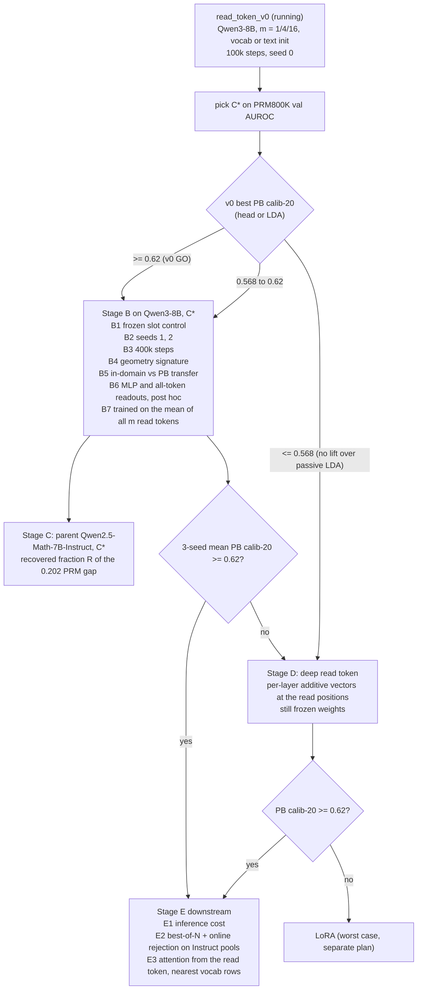

# read_token_v1: controls, the parent model, and downstream use of a learned read token

Frozen 2026-10-19, before any read_token_v0 result was read (TamIA 629398 smoke,
629399 full, both pending at freeze time).

## Why

§21.31 located the PRM's advantage at one position: at the `<extra_0>` separator
its head reads, closed-form LDA matches the head (ProcessBench calib-20 0.704
against 0.700), correctness is the first principal component, and the raw
class-mean axis alone reaches 0.685. Reading the same PRM pass at the step's own
tokens loses most of it (last token 0.642, step mean 0.590). The parent,
Qwen2.5-Math-7B-Instruct, holds the signal only as a low-variance margin (best
passive LDA 0.502, L20 last token), and so does Qwen3-8B (0.568, L35 last
token). Process supervision turned a hidden margin into the dominant direction
at a trained read position.

read_token_v0 (`docs/read_token_v0_plan.md`) asks whether a frozen Qwen3-8B can
be given such a position by training only m appended soft-token embeddings and a
linear head. v0 is one seed, one backbone, 100k training steps, and has no
control that separates "having a slot" from "optimizing the slot". v1 adds that
control, the parent model, seeds, more data, the geometry signature, and the
downstream use. LoRA stays out of scope; a deep read token is the last
frozen-weight fallback before it.

The read token `<v>` alone is the headline readout in every stage: the head and
LDA read only the final-layer state of the last soft token, never concatenated
with the step's own states.

## Mechanism

```
 input:  [verifier template] [problem] [steps 1..i-1] [step i]  <v>_1 ... <v>_m
                     \____________ frozen Qwen, no grad, KV cached ____/   |
                                                                          |  attends to the cache
                                                                          v
                                          final post-norm state of <v>_m (4096-d)
                                                                          |
                                                          linear head ->  P(step i incorrect)

 trained:  the m x 4096 soft embeddings and the head (BCE, 1 = incorrect)
 frozen:   every backbone weight; no prefix token attends to <v>, so the
           policy's text and token states are unchanged
```

## Questions

* **Q1, slot or optimization.** Does a fixed, untrained token at the same
  position (head and LDA trained, embedding frozen at its initialisation) already
  give most of the gain? If so, the PRM's advantage is mostly a place to read,
  not something a learned query computes.
* **Q2, robustness.** Does the best v0 configuration hold across seeds, and does
  it improve with 4x the training steps?
* **Q3, geometry.** Does the read token reproduce the PRM's signature, with
  correctness among the top principal components and the raw class-mean axis
  close to LDA, or is it still a whitened low-variance margin?
* **Q4, parent.** On Qwen2.5-Math-7B-Instruct, how much of the PRM-minus-parent
  gap (0.704 - 0.502 = 0.202 calib-20) does a read token recover with no weight
  change?
* **Q5, downstream.** Does the read token change best-of-N and online rejection
  on the Instruct policy, and at what inference cost?
* **Q6, readout.** Does a nonlinear readout get more out of the read-token state
  than LDA, and does reading all m read tokens beat reading only the last one?
  The last token attends to the earlier ones, so their content is reachable in
  principle; this asks whether it gets there in practice.

## Selection rule

C* is the v0 configuration (m, init) with the highest PRM800K val AUROC of its
trained head. ProcessBench is never used to select. If two configurations are
within 0.002 val AUROC, take the smaller m.

## Stages



**Stage B (Qwen3-8B, C\*).** One node, one run per GPU.

| run | soft embeddings | seed | training steps |
|---|---|---|---|
| B1 frozen slot | fixed at C*'s initialisation | 0 | 100k |
| B2a | trained | 1 | 100k |
| B2b | trained | 2 | 100k |
| B3 | trained | 0 | 400k |

All runs reuse v0's encode and `scripts/analysis/backbone_geometry.py` (rep
`sep`, layer -1), so every run reports head and LDA scores, the raw class-mean
axis and the best single PC with its index. B5 is computed from these outputs:
the gain over passive L35 last-token LDA (test AUROC 0.890, calib-20 0.568) on
PRM800K test and on ProcessBench, side by side.

Two readout checks (Q6), with m_all = C*'s m if it is above 1, otherwise the v0
configuration with the highest val AUROC among m in {4, 16}:

* B6, post hoc, no backbone pass: on stored states, fit the leaderboard
  `mlp h1024` on the last read-token state of C* and compare it with LDA on the
  same state. On m_all's v0 tokens, re-encoded to keep all m states, fit LDA on
  their mean and an attention-pooled linear head (`attn_query`) over the m
  states.
* B7, trained: m_all with the head reading the mean of all m final states
  instead of the last one, seed 0, 100k steps; scored like every other run (LDA
  stays 4096-d). B7 runs on a second node or after Stage B's four runs.

**Stage C (parent).** C* on Qwen2.5-Math-7B-Instruct, verifier template, seeds
0, 1, 2. R = (mean calib-20 - 0.502) / 0.202, from LDA on the read-token state,
so it is comparable to the LDA figures for the parent and the PRM in §21.31.

**Stage D (fallback, frozen weights).** Each decoder layer adds a trained vector
delta_l to the hidden state at the read positions only, through a forward hook
active during the soft-token pass. Parameters: m x 4096 x n_layers (147k at m = 1
on Qwen3-8B). With all delta_l = 0 it is exactly v0. Same data, seeds and scoring
as Stage B.

**Stage E (downstream, only after a GO).**

* E1: wall time per scored step for the read token (one extra m-token pass over
  the step's KV cache) against the passive readout, measured on the same node.
* E2: score the Instruct on-policy candidate pools of §21.13 with the read token
  and run the same best-of-N aggregators and the online rejection protocol of
  §21.14 and §21.27, against the `step_tokens x d512` cell and the PRM on the
  same candidates.
* E3: attention mass from the read token per layer to the problem, the prior
  steps and the current step (attention_routing tooling, token-0 sink reported
  separately), and the 10 nearest vocabulary rows to each trained embedding by
  cosine.

## Prespecified readings (ProcessBench calib-20, four-subset mean)

* **Q1.** B1 frozen slot within 0.02 of C* (seed 0): the slot does most of the
  work. B1 at least 0.05 below C*: optimizing the query matters.
* **Q2, GO for Stage E.** 3-seed mean of C* >= 0.62 (v0's bar, above the best
  trained Qwen3-8B cell at 0.610), from the head or LDA. B3 minus seed 0 >= +0.02:
  the read token is data-limited at 100k steps; rerun Stage C at 400k.
* **Q3.** Correctness axis among the top 3 PCs and raw class-mean axis >= 0.9 x
  LDA calib-20: the read token reproduces the PRM's reorganisation. Best PC index
  >= 8 and raw axis < 0.6 x LDA: it found the same hidden margin, not a new
  geometry.
* **Q4.** R >= 0.5: a read token recovers most of what process supervision
  bought at the read position. R <= 0.15: process supervision changed something
  a single input vector cannot reach.
* **Q5, transfer warning.** A PRM800K test AUROC gain over passive L35 LDA with
  a ProcessBench calib-20 gain <= 0: the token learned PRM800K regularities
  (the OptiPrompt and PEP failure mode), and Stage E does not run.
* **Q5, downstream.** Read off against the d512 cell on the same candidates with
  the paired bootstrap already used in §21.13; no new bar.
* **Q6, nonlinear readout.** B6 MLP within 0.01 of LDA on the same state: the
  read token linearised the signal, as at the PRM's separator (head 0.700, LDA
  0.704). MLP at least 0.03 above LDA: the token gathered the signal without
  linearising it, and Stage D trains with the MLP head before adding per-layer
  deltas.
* **Q6, all read tokens.** B7 or B6's all-token readouts at least 0.02 above the
  last-token readout of the same m: the earlier read tokens hold signal the last
  one does not absorb, and Stages C to E read all m tokens (mean, or attention
  pooling if it wins). Within 0.01: keep the last token.

## Stage D2: start point of the deep read token (added after Stage D's GO)

Stage D passed with C* = m4text, whose start is the last four tokens of
"\n\nIs this step correct?" (` this step correct?`). v0 picked m = 4 because
that start was cut to four tokens; a one-token start from text was never run.
Stage D2 asks how much of Stage D's result needs a question-shaped start, and
whether one read token is enough. Everything is as in Stage D seed 0 (deep,
linear head, 100k steps, cuDNN SDPA excluded); only the start text changes, and
m is its Qwen3 token count.

| run | start text | m |
|---|---|---|
| dq_is_step_correct | ` Is step correct?` | 4 |
| dq_correct_q | ` correct?` | 2 |
| dq_q | `?` | 1 |
| dq_correct | ` correct` | 1 |

Readings, from LDA PB calib-20 with the head alongside. Stage D's seeds span
0.638 to 0.649, so gaps under 0.01 are not read.

* `dq_is_step_correct` within 0.01 of Stage D seed 0 (0.639): the question
  wording beyond "step correct?" does not matter (sanity check).
* A one-token run (`dq_q` or `dq_correct`) at or above 0.638: one deep read
  token is enough, and Stage E uses it (four times fewer read positions).
* `dq_correct_q` or `dq_q` at least 0.01 above `dq_correct`: the question mark,
  not the word, carries the useful start.
* All four within 0.01 of one another: once per-layer offsets exist, the start
  point does not matter.

## Stage F: leaderboard learners on the deep read token (added before D2 results)

So far every read-token number comes from its own jointly trained head or from
LDA, scored on read_token's own encode of ProcessBench. Stage F puts the read
token into the leaderboard itself: the same items, splits, trainer, hyperparameter
protocol, seeds (42, 43, 44) and calib-20 as the Qwen3-8B Instruct rows
(`scripts/train_rep_learner_cell.py`, RESCALE none), so its cells sit in the
same table as `step_tokens x d512` (0.610 +- 0.007) and the PRM-state cells
(best 0.661 +- 0.003).

**Token.** One deep read token, picked on PRM800K val AUROC of its head among the
seed-0 runs (Stage D's m4text and the four D2 starts), with read_token_select's
rule (within 0.002, the smaller m wins). ProcessBench is not read.

**Stores** (`scripts/read_token_store.py`), one entry per item of the Instruct
step-span stores (513,810 train steps, val_5k, test_2k, four ProcessBench
subsets), in their order and with their meta and labels; one unmatched item or
PRM800K label disagreement stops the job:

* `rt_layers`: per item, the last read token's output at blocks 3, 7, 11, 15,
  19, 23, 27, 31, 34 (pre-norm, offsets included) followed by its final
  post-norm state, the one the head reads. About 45 GB for train.
* `rt_append`: the last read token's block-34 output (hidden_states[35], the
  layer the step-span store holds), one row per item.

**Cells.**

| id | rep | learners | what it asks |
|---|---|---|---|
| F-A | final read-token state (`last_token` over rt_layers) | linear, mlp h1024, mlp h1024x2 | bridge to the head; nonlinear headroom |
| F-B | read token through the layers (`step_tokens` over rt_layers) | attn_query, transformer d512 | do intermediate layers hold more than the final state? |
| F-C | step tokens + the read token's row appended (`--append_store`) | transformer d512 | does the read token add to the leaderboard's best cell? |

F-C reuses the lr and weight decay that the Instruct `step_tokens x d512` cell
selected (`--hp_from`), rather than searching again: one search costs about 5 h
on this store, and the appended token changes the input by one position. F-A and
F-B search as every leaderboard cell does.

**Readings** (3-seed mean calib-20 F1_PB, four-subset mean):

* F-A linear within 0.01 of the picked token's own head (seed 0): read_token's
  scoring and the leaderboard's agree, and Stage D's numbers carry over.
* F-A MLP at least 0.02 above F-A linear: the deep token left nonlinear headroom
  (the plain token did not, B6).
* Best F-B at least 0.02 above best F-A: the read token's intermediate states
  hold signal its final state does not pass on.
* F-C at least 0.02 above `step_tokens x d512` (0.610), with the paired trace
  bootstrap of §21.13 excluding 0: the read token adds to the step tokens. F-C at
  least 0.02 above best F-A: the step tokens add to the read token.
* Leaderboard: the best Stage F cell tops the Qwen3-8B rows if its mean beats
  0.610 with the paired bootstrap excluding 0, and matches the PRM states if it
  is within 0.01 of 0.661.

**Jobs** (`slurm/read_token_leaderboard_tamia.sh`): `store` after D2 (one node),
then `fab` (one node) and `fc` (two nodes, seeds 42 and 43 on one, 44 on the
other, two 163 GB span preloads per node at most). Calib-20 for each cell
directory with `scripts/merge_rep_grid_leaderboard.py`.

## Code needed

* `scripts/read_token_probe.py`: `--freeze_soft` (embedding excluded from the
  optimizer, for B1), `--read {last,mean}` in train and `--keep_all` in encode
  (store all m states, for B6 and B7), and `--deep` (Stage D hooks). Tests:
  `--freeze_soft` leaves the embedding bit-identical after training; with m = 1,
  `--read mean` equals `--read last`; `--deep` with zero deltas matches v0's read
  state.
* E3: an attention dump for the soft pass (eager attention, read positions only).
* Stage C needs only `--model Qwen/Qwen2.5-Math-7B-Instruct`; the weights are
  already cached on TamIA from backbone_geometry_v0.

## Cost

Set each stage's `--time` from v0's logged train and encode times. Stage B is one
H100:4 node, with B3 the longest run (about 4x a v0 config's train time). Stage
C is one node with three seeds. Only trained tokens, geometry JSON and logs leave
the node, as in v0.
