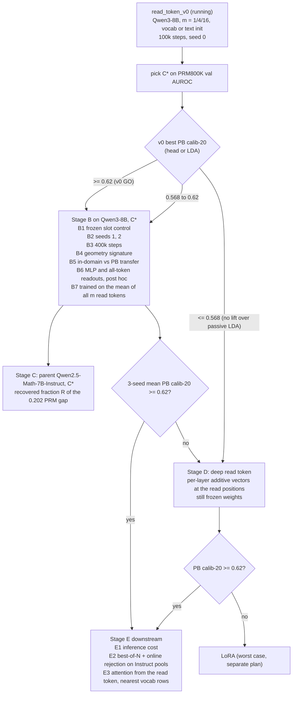

# read_token_v1: controls, the parent model, and downstream use of a learned read token

Frozen 2026-10-19, before any read_token_v0 result was read (TamIA 629398 smoke,
629399 full, both pending at freeze time).

## Why

§21.31 located the PRM's advantage at one position: at the `<extra_0>` separator
its head reads, closed-form LDA matches the head (ProcessBench calib-20 0.704
against 0.700), correctness is the first principal component, and the raw
class-mean axis alone reaches 0.685. Reading the same PRM pass at the step's own
tokens loses most of it (last token 0.642, step mean 0.590). The parent,
Qwen2.5-Math-7B-Instruct, holds the signal only as a low-variance margin (best
passive LDA 0.502, L20 last token), and so does Qwen3-8B (0.568, L35 last
token). Process supervision turned a hidden margin into the dominant direction
at a trained read position.

read_token_v0 (`docs/read_token_v0_plan.md`) asks whether a frozen Qwen3-8B can
be given such a position by training only m appended soft-token embeddings and a
linear head. v0 is one seed, one backbone, 100k training steps, and has no
control that separates "having a slot" from "optimizing the slot". v1 adds that
control, the parent model, seeds, more data, the geometry signature, and the
downstream use. LoRA stays out of scope; a deep read token is the last
frozen-weight fallback before it.

The read token `<v>` alone is the headline readout in every stage: the head and
LDA read only the final-layer state of the last soft token, never concatenated
with the step's own states.

## Mechanism

```
 input:  [verifier template] [problem] [steps 1..i-1] [step i]  <v>_1 ... <v>_m
                     \____________ frozen Qwen, no grad, KV cached ____/   |
                                                                          |  attends to the cache
                                                                          v
                                          final post-norm state of <v>_m (4096-d)
                                                                          |
                                                          linear head ->  P(step i incorrect)

 trained:  the m x 4096 soft embeddings and the head (BCE, 1 = incorrect)
 frozen:   every backbone weight; no prefix token attends to <v>, so the
           policy's text and token states are unchanged
```

## Questions

* **Q1, slot or optimization.** Does a fixed, untrained token at the same
  position (head and LDA trained, embedding frozen at its initialisation) already
  give most of the gain? If so, the PRM's advantage is mostly a place to read,
  not something a learned query computes.
* **Q2, robustness.** Does the best v0 configuration hold across seeds, and does
  it improve with 4x the training steps?
* **Q3, geometry.** Does the read token reproduce the PRM's signature, with
  correctness among the top principal components and the raw class-mean axis
  close to LDA, or is it still a whitened low-variance margin?
* **Q4, parent.** On Qwen2.5-Math-7B-Instruct, how much of the PRM-minus-parent
  gap (0.704 - 0.502 = 0.202 calib-20) does a read token recover with no weight
  change?
* **Q5, downstream.** Does the read token change best-of-N and online rejection
  on the Instruct policy, and at what inference cost?
* **Q6, readout.** Does a nonlinear readout get more out of the read-token state
  than LDA, and does reading all m read tokens beat reading only the last one?
  The last token attends to the earlier ones, so their content is reachable in
  principle; this asks whether it gets there in practice.

## Selection rule

C* is the v0 configuration (m, init) with the highest PRM800K val AUROC of its
trained head. ProcessBench is never used to select. If two configurations are
within 0.002 val AUROC, take the smaller m.

## Stages



**Stage B (Qwen3-8B, C\*).** One node, one run per GPU.

| run | soft embeddings | seed | training steps |
|---|---|---|---|
| B1 frozen slot | fixed at C*'s initialisation | 0 | 100k |
| B2a | trained | 1 | 100k |
| B2b | trained | 2 | 100k |
| B3 | trained | 0 | 400k |

All runs reuse v0's encode and `scripts/analysis/backbone_geometry.py` (rep
`sep`, layer -1), so every run reports head and LDA scores, the raw class-mean
axis and the best single PC with its index. B5 is computed from these outputs:
the gain over passive L35 last-token LDA (test AUROC 0.890, calib-20 0.568) on
PRM800K test and on ProcessBench, side by side.

Two readout checks (Q6), with m_all = C*'s m if it is above 1, otherwise the v0
configuration with the highest val AUROC among m in {4, 16}:

* B6, post hoc, no backbone pass: on stored states, fit the leaderboard
  `mlp h1024` on the last read-token state of C* and compare it with LDA on the
  same state. On m_all's v0 tokens, re-encoded to keep all m states, fit LDA on
  their mean and an attention-pooled linear head (`attn_query`) over the m
  states.
* B7, trained: m_all with the head reading the mean of all m final states
  instead of the last one, seed 0, 100k steps; scored like every other run (LDA
  stays 4096-d). B7 runs on a second node or after Stage B's four runs.

**Stage C (parent).** C* on Qwen2.5-Math-7B-Instruct, verifier template, seeds
0, 1, 2. R = (mean calib-20 - 0.502) / 0.202, from LDA on the read-token state,
so it is comparable to the LDA figures for the parent and the PRM in §21.31.

**Stage D (fallback, frozen weights).** Each decoder layer adds a trained vector
delta_l to the hidden state at the read positions only, through a forward hook
active during the soft-token pass. Parameters: m x 4096 x n_layers (147k at m = 1
on Qwen3-8B). With all delta_l = 0 it is exactly v0. Same data, seeds and scoring
as Stage B.

**Stage E (downstream, only after a GO).**

* E1: wall time per scored step for the read token (one extra m-token pass over
  the step's KV cache) against the passive readout, measured on the same node.
* E2: score the Instruct on-policy candidate pools of §21.13 with the read token
  and run the same best-of-N aggregators and the online rejection protocol of
  §21.14 and §21.27, against the `step_tokens x d512` cell and the PRM on the
  same candidates.
* E3: attention mass from the read token per layer to the problem, the prior
  steps and the current step (attention_routing tooling, token-0 sink reported
  separately), and the 10 nearest vocabulary rows to each trained embedding by
  cosine.

## Prespecified readings (ProcessBench calib-20, four-subset mean)

* **Q1.** B1 frozen slot within 0.02 of C* (seed 0): the slot does most of the
  work. B1 at least 0.05 below C*: optimizing the query matters.
* **Q2, GO for Stage E.** 3-seed mean of C* >= 0.62 (v0's bar, above the best
  trained Qwen3-8B cell at 0.610), from the head or LDA. B3 minus seed 0 >= +0.02:
  the read token is data-limited at 100k steps; rerun Stage C at 400k.
* **Q3.** Correctness axis among the top 3 PCs and raw class-mean axis >= 0.9 x
  LDA calib-20: the read token reproduces the PRM's reorganisation. Best PC index
  >= 8 and raw axis < 0.6 x LDA: it found the same hidden margin, not a new
  geometry.
* **Q4.** R >= 0.5: a read token recovers most of what process supervision
  bought at the read position. R <= 0.15: process supervision changed something
  a single input vector cannot reach.
* **Q5, transfer warning.** A PRM800K test AUROC gain over passive L35 LDA with
  a ProcessBench calib-20 gain <= 0: the token learned PRM800K regularities
  (the OptiPrompt and PEP failure mode), and Stage E does not run.
* **Q5, downstream.** Read off against the d512 cell on the same candidates with
  the paired bootstrap already used in §21.13; no new bar.
* **Q6, nonlinear readout.** B6 MLP within 0.01 of LDA on the same state: the
  read token linearised the signal, as at the PRM's separator (head 0.700, LDA
  0.704). MLP at least 0.03 above LDA: the token gathered the signal without
  linearising it, and Stage D trains with the MLP head before adding per-layer
  deltas.
* **Q6, all read tokens.** B7 or B6's all-token readouts at least 0.02 above the
  last-token readout of the same m: the earlier read tokens hold signal the last
  one does not absorb, and Stages C to E read all m tokens (mean, or attention
  pooling if it wins). Within 0.01: keep the last token.

## Stage D2: start point of the deep read token (added after Stage D's GO)

Stage D passed with C* = m4text, whose start is the last four tokens of
"\n\nIs this step correct?" (` this step correct?`). v0 picked m = 4 because
that start was cut to four tokens; a one-token start from text was never run.
Stage D2 asks how much of Stage D's result needs a question-shaped start, and
whether one read token is enough. Everything is as in Stage D seed 0 (deep,
linear head, 100k steps, cuDNN SDPA excluded); only the start text changes, and
m is its Qwen3 token count.

| run | start text | m |
|---|---|---|
| dq_is_step_correct | ` Is step correct?` | 4 |
| dq_correct_q | ` correct?` | 2 |
| dq_q | `?` | 1 |
| dq_correct | ` correct` | 1 |

Readings, from LDA PB calib-20 with the head alongside. Stage D's seeds span
0.638 to 0.649, so gaps under 0.01 are not read.

* `dq_is_step_correct` within 0.01 of Stage D seed 0 (0.639): the question
  wording beyond "step correct?" does not matter (sanity check).
* A one-token run (`dq_q` or `dq_correct`) at or above 0.638: one deep read
  token is enough, and Stage E uses it (four times fewer read positions).
* `dq_correct_q` or `dq_q` at least 0.01 above `dq_correct`: the question mark,
  not the word, carries the useful start.
* All four within 0.01 of one another: once per-layer offsets exist, the start
  point does not matter.

## Stage F: leaderboard learners on the deep read token (added before D2 results)

So far every read-token number comes from its own jointly trained head or from
LDA, scored on read_token's own encode of ProcessBench. Stage F puts the read
token into the leaderboard itself: the same items, splits, trainer, hyperparameter
protocol and calib-20 as the Qwen3-8B Instruct rows, at seed 42 only
(`scripts/train_rep_learner_cell.py`, RESCALE none), so its cells sit in the
same table as `step_tokens x d512` (0.610 +- 0.007) and the PRM-state cells
(best 0.661 +- 0.003).

**Token.** One deep read token, picked on PRM800K val AUROC of its head among the
seed-0 runs (Stage D's m4text and the four D2 starts), with read_token_select's
rule (within 0.002, the smaller m wins). ProcessBench is not read.

**Stores** (`scripts/read_token_store.py`), one entry per item of the Instruct
step-span stores (513,810 train steps, val_5k, test_2k, four ProcessBench
subsets), in their order and with their meta and labels; one unmatched item or
PRM800K label disagreement stops the job:

* `rt_layers`: per item, the last read token's output at blocks 3, 7, 11, 15,
  19, 23, 27, 31, 34 (pre-norm, offsets included) followed by its final
  post-norm state, the one the head reads. About 45 GB for train.
* `rt_append`: the last read token's block-34 output (hidden_states[35], the
  layer the step-span store holds), one row per item.
* `rt_traj` (`scripts/read_token_traj.py`): per item, the read token's final
  post-norm state at the current step, then at each previous step of the same
  trajectory, most recent first, each read under its own prefix as that step
  would be read as an item. Most recent first puts the current step at position
  0 and makes position p mean "p steps back" whatever the trajectory's length.
  ProcessBench previous steps are the trace's own steps and are all items of
  the store, so none is re-encoded. PRM800K previous steps are the prefix split
  on blank lines (a step containing one becomes two rows); in train, 2,928,144
  previous-step rows reduce to 276,201 texts that are not themselves train items
  and need encoding (val 3,623 of 27,590, test 1,515 of 10,341). Mean 5.7
  previous steps per train item, about 32 GB.

**Cells.**

| id | rep | learners | what it asks |
|---|---|---|---|
| F-A | final read-token state (`last_token` over rt_layers) | linear, mlp h1024, mlp h1024x2 | bridge to the head; nonlinear headroom |
| F-B | read token through the layers (`step_tokens` over rt_layers) | transformer d512 | do intermediate layers hold more than the final state? |
| F-T | read token along the trajectory (`step_tokens` over rt_traj) | transformer d512 | do the previous steps' verdicts add to the current one? |
| F-C | step tokens + the read token's row appended (`--append_store`) | transformer d512 | does the read token add to the leaderboard's best cell? |

Every cell searches lr and weight decay as the leaderboard's seed-42 cells do
(the Instruct `step_tokens x d512` seed-42 search and refit took 3,310 s).
One seed per cell, so the ablations run in parallel on one node: the
leaderboard's seed std is 0.003 to 0.007 for these cells, so the 0.02 margins
below are about 3 std of one seed, and gaps under 0.02 are unread. Seeds 43
and 44 can be added to F-C afterwards (`fc`, reusing its seed-42 selection).

**Readings** (seed-42 calib-20 F1_PB, four-subset mean):

* F-A linear within 0.01 of the picked token's own head (seed 0): read_token's
  scoring and the leaderboard's agree, and Stage D's numbers carry over.
* F-A MLP at least 0.02 above F-A linear: the deep token left nonlinear headroom
  (the plain token did not, B6).
* F-B at least 0.02 above best F-A: the read token's intermediate states
  hold signal its final state does not pass on.
* F-T at least 0.02 above best F-A: the read states of the previous steps add to
  the current one, although the current read token already attends to their text.
  PRM800K previous steps are labeler-chosen and almost never wrong, so F-T learns
  what a clean history looks like. On ProcessBench, the steps up to the first
  error have the same clean history, and those steps decide the first-error
  prediction.
* F-C at least 0.02 above `step_tokens x d512` (0.610), with the paired trace
  bootstrap of §21.13 excluding 0: the read token adds to the step tokens. F-C at
  least 0.02 above best F-A: the step tokens add to the read token.
* Leaderboard: the best Stage F cell tops the Qwen3-8B rows if it beats 0.610
  by 0.02 with the paired bootstrap excluding 0, and matches the PRM states if it
  is within 0.01 of 0.661. A claim on the table itself needs seeds 43 and 44.

**Jobs** (`slurm/read_token_leaderboard_tamia.sh`): `store` after D2, one node:
pick, stores, then one lane per GPU in parallel: F-C on GPU 0 as soon as
rt_append exists, while GPUs 1-3 encode rt_traj's previous steps (about 16 min);
then F-B, F-T and the three F-A cells in turn. The stores stay on node-local disk
because shared scratch is near quota. Memory: F-C preloads 163 GB of step spans,
F-B about 42 GB, F-T about 32 GB, on a 500 GB node. `fc` adds F-C seeds later. Calib-20 for each cell
directory with `scripts/merge_rep_grid_leaderboard.py`.

## Method names (added 2026-10-22)

* **RTH (Read-Token Head):** the deep read token classified by its own linear
  head, trained jointly with the token's embedding and per-layer offsets. One extra
  token pass, one dot product. ProcessBench scores in the leaderboard format:
  `scripts/analysis/rth_scores.py`.
* **DRV (Depth-Read Verifier):** the same frozen token, read at blocks 3, 7, ...,
  31, 34 and its final state by the leaderboard's d512 transformer, trained
  afterwards (Stage F-B).

Run and token directory names (`dq_correct`, `df_correct_full_seed*`) name the
token, not the readout; RTH and DRV name the classifier.

## Stage DF: the D2 pick on the full train split (added after Stage F)

The ` correct` deep read token (m = 1, linear head, as `dq_correct`) trained on all
513,810 PRM800K train steps for one epoch instead of 100k, seeds 0, 1, 2; every
other setting and the scoring (own head and LDA, `backbone_geometry.py`) as in
Stage D2. B3 is the precedent: 400k steps raised m4text's head by 0.031 and its
LDA by 0.012. The LDA fit subsample (30k train rows) now lies wholly inside the
token's training data; test and ProcessBench stay held out.

Readings (ProcessBench calib-20, four-subset mean, own head unless stated):

* Seed 0 minus `dq_correct` (0.656) at least +0.02: the deep token is data-limited
  at 100k steps.
* 3-seed mean at least 0.630 (0.02 above `step_tokens x d512`, 0.610), with the
  paired trace bootstrap excluding 0: the head alone tops the Qwen3-8B rows.
* 3-seed mean within 0.01 of 0.661: it matches the PRM states' best cell. The
  PRM's own head (0.701) stays the ceiling.
* DRV is rebuilt on this token only if its head does not reach DRV's 0.641.
* Seed 2 diverged at the end of warm-up with peak lr 3e-3 (job 635351, loss 1.27 at
  step 500, 0.598 at the end); it is rerun with peak lr 1e-3 (`STAGE=DFLR`) and
  reported as its own row, not averaged with the 3e-3 seeds.

## Stage E: RTH downstream (added 2026-10-26, before any downstream run)

RTH seed by PRM800K val AUROC among `dq_correct` (seed 0), `rth_correct_seed1`,
`rth_correct_seed2` (100k steps each); ProcessBench is not read for the pick.
Job: `slurm/rth_downstream_tamia.sh`.

* **D1, selection.** RTH scores every step of the saved Instruct pools of §21.13
  (T=1.0 primary, T=0.7 sensitivity; GSM8K test and MATH-500, ten samples), each
  step read under the verifier template with its own trajectory's earlier steps as
  context (`scripts/onpolicy/score_traces_with_read_token.py`), steps from
  `split_into_steps` with the step count checked against the PRM's score files.
  Rules as in §21.13 (`tts_rule_contrast.py`: majority, tie-break, best-of-N,
  weighted vote, N = 2, 4, 10, worst step), question-cluster paired bootstrap.
  Within-problem trajectory AUROC (worst step and mean step).
* **D2, confidence-wrong pairs.** `pair_complementarity.py` with RTH as the probe on
  the T=1.0 pool: the 985 MATH-500 pairs where mean token confidence prefers the
  wrong answer, question-weighted, question bootstrap.
* **E1, cost.** `scripts/analysis/rth_cost.py`: 200 MATH-500 trajectories, one at a
  time on one H100: RTH, one Qwen3-8B pass over the trajectory (the passive probes'
  cost), one PRM pass in its native template.

Readings (T=1.0 pool; T=0.7 must agree in sign to be reported as a finding):

* Tie-break at N=2 on MATH-500: RTH's lift over majority at least the best probe's
  (+1.84, `boundary_stats x mlp h1024x2`) makes it the best probe tie-breaker;
  within 0.2 of the PRM's +2.02, it matches the PRM there. GSM8K the same against
  +0.57 and +1.30.
* Overriding majority: RTH best-of-N or weighted vote at N=10 above majority with
  the paired interval excluding 0 (only the PRM did this in §21.13, on GSM8K).
* Within-problem AUROC on MATH-500 (worst step): above the best probe's 0.643 is a
  better ranker; within 0.02 of the PRM's 0.709 matches it.
* D2: at least 0.60 with the interval above 0.5 on the confidence-wrong pairs means
  RTH escapes the policy's confidence blind spot (PRM head 0.629, frozen Qwen3-8B
  readouts 0.44 to 0.52).
* E1 is reported, not read against a bar.

## Stage G: baselines and mechanistic study (added 2026-10-27, before any run)

Why: RTH ties the PRM states on ProcessBench (0.659 +- 0.003, 3 seeds) but the
claim that the per-layer offsets are the ingredient, and the reason RTH stays tied
to the policy's confidence (0.530 on the 985 confidence-wrong MATH-500 pairs), need
baselines and a mechanism. Everything on frozen Qwen3-8B, the verifier template, the
same 100k PRM800K steps, 3 seeds, the same scoring as RTH: the head's ProcessBench
calib-20 through the leaderboard code (`scripts/analysis/read_token_pb_scores.py`,
paired trace bootstrap against RTH), PRM800K test AUROC, LDA, and the
confidence-wrong pairs.

**Baselines.**

| id | trained | params | stage |
|---|---|---|---|
| BL1 embedding only (ScratchProbe-style) | ` correct` embedding + linear head, no offsets | ~8k | BLA |
| BL1-SP ScratchProbe recipe | 8 scratch tokens + read token (m = 9, vocabulary init), ReLU MLP head h1024, no offsets | ~4.2M | BLA, BLB |
| BL2 offsets only | 36 offsets + head, embedding frozen at ` correct` | ~152k | BLB |
| BL3 LoReFT at the read position | rank-4 subspace edit per layer, read position only | ~1.2M | later (new hook) |
| BL4 read-position LoRA (OTV-like) | rank-8 LoRA on q, v, active only for the read token | ~3.8M | later (new hook) |

Readings (3-seed means, calib-20 F1_PB):

* BL1 at least 0.02 below RTH: the offsets are the ingredient.
* BL2 within 0.01 of RTH: training the embedding adds nothing once offsets exist.
* BL3 within 0.01 of RTH: a bias per layer is enough; at least 0.02 above: a richer
  intervention helps.
* BL4 at least 0.02 above RTH, or any baseline at 0.60 or more on the
  confidence-wrong pairs with the interval above 0.5: the confidence coupling is a
  matter of capacity; otherwise it is a property of reading a frozen policy.

**Mechanistic study** (the bundle under
`/project/aip-azouaq/dchikhi/cot_mech/read_token_v1/mech`, token `dq_correct`):

* M1 (`scripts/analysis/rth_layer_lda.py`, `slurm/rth_layer_lda_tamia.sh`): per-layer
  LDA (fit on the bundle's 20k train sample, shrinkage on val) for the last step
  token, the read token and the PRM; test AUROC, ProcessBench AUROC and calib-20 per
  layer. Reading: the read token's advantage appearing only in the last third of the
  layers means the offsets reshape the readout; appearing earlier means they change
  what the token gathers.
* M2: offsets switched off by layer window (0-8, 9-17, 18-26, 27-35), offset norm
  relative to the residual, what the offsets write in vocabulary space. Reading: one
  window carrying 70% or more of the gain locates the mechanism.
* M3: per-layer attention mass from the read token (problem, prior steps, current
  step, sink), RTH against BL1, 2k test items.
* M4: a linear confidence readout (step token log-probs under the policy) fit on the
  read state and projected out of RTH's direction. Reading: calib-20 down 0.02 or
  more means the coupling is load-bearing; down less than 0.01 with the pair accuracy
  rising means a decoupled RTH is within reach.
* M5: the PRM's own head score regressed from the read state per layer; agreement on
  the pairs where RTH and the PRM disagree.

## Stage H: the read token inside the trace, Plan B (added 2026-10-27, before any run)

**Why.** RTH reads a step under the verifier template rebuilt per step, so scoring
re-reads the trajectory once per step: 28,821 tokens per MATH-500 trajectory, 1,642
with prefix sharing, against 845 for the PRM (E1). Its states are not the ones the
policy computed while writing, so nothing is reused from generation.

**Layout (RTH-I).** One pass per trajectory in Qwen3-8B's chat layout (the D1/D2
pool's `chat_prompt`, non-thinking), one read token after each step's separator:

    chat_prompt(problem) s0 \n\n [v] s1 \n\n [v] ... sK \n\n [v]

No text token attends to a read token (4D mask), so the text states are the
generation states. Read token k sees the text up to the end of step k's separator
and itself, at the position the next text token would take: the same computation
as appending the token to the generation cache after step k and dropping it.
`scripts/read_token_inline.py`: text pass without gradients, then all read tokens
of a batch in one call over the cache; offsets at every read position; m = 1 only.

**Same supervision as RTH.** The same 100k PRM800K items per seed (same sampler and
seed), labels, BCE, AdamW, OneCycle at lr 3e-3 and clip 1.0. Items of one solution
ride on its longest item (an item reads exactly the tokens it would read alone; one
without a token boundary at its separator is read alone, and the count is logged).
Batches are capped at RTH's items per optimizer step on the same items, so the
number of optimizer steps stays close to RTH's. Only the layout changes.

**Stages.**

* H0, equivalence: tests on the tiny model (inline read equals a read token
  appended to each standalone prefix, with non-zero offsets and gradients; passive
  states equal the plain text states), and a gate at the start of every training
  run on the real model (relative difference <= 0.05, as RTH's cache gate).
* H1, layout gap: the three RTH tokens, unchanged, read inline (no training).
* H2, RTH-I: seeds 0-2 trained inline. Each encode also stores the text states at
  the separator token before every read token (`passive_block24`, `passive_block35`,
  `passive_final`); LDA on them is the passive control, the free probe on the same
  states (`scripts/analysis/inline_passive_lda.py`).
* H3, downstream and cost (after H2): MATH-500 / GSM8K T=1.0 pools scored in one
  pass, Stage E's D1/D2 metrics, and E1 cost on two lines: rescoring (text + K read
  tokens) and the online margin (K read tokens over an existing cache).
* H4, online (after H3): append, read and drop during generation; online scores
  must equal H3's offline scores on 50 traces before online rejection.

**Prespecified readings (H2, calib-20 F1_PB, four-subset mean, 3 seeds).**

* GO for H3: RTH-I mean >= 0.649 (RTH 0.659 minus 0.01) and above the best
  passive-control LDA row.
* RTH-I below 0.649 but above the passive control: the read token still adds over
  the free probe; fallbacks in order: m = 4 read tokens, then a read-position LoRA
  (text untouched, if BL4 helps), else keep Option A for offline scoring.
* RTH-I at or below the passive control: the read token's gain needs the template;
  report it, keep RTH with Option A.
* H1 is descriptive: its gap to RTH measures how much of RTH is tied to the template.

No instruction is added to the policy prompt: it would change generation (the
PRM800K few-shot prompt cost 6 points of MATH pass@1).

**Novelty caveat.** A separator read in one pass is the PRM's own layout, and OTV
(arXiv 2603.01025) reads a learned token over a reused cache with LoRA. The claim
Stage H can support is narrower: a frozen policy, no weight change, one token per
step, compared with the PRM at matched cost (H3).

**Job.** `slurm/read_token_inline_tamia.sh` (H1 + H2 on one node, then the paired
trace bootstrap of RTH-I against RTH, the PRM-state cells and H1).

## Code needed

* `scripts/read_token_probe.py`: `--freeze_soft` (embedding excluded from the
  optimizer, for B1), `--read {last,mean}` in train and `--keep_all` in encode
  (store all m states, for B6 and B7), and `--deep` (Stage D hooks). Tests:
  `--freeze_soft` leaves the embedding bit-identical after training; with m = 1,
  `--read mean` equals `--read last`; `--deep` with zero deltas matches v0's read
  state.
* E3: an attention dump for the soft pass (eager attention, read positions only).
* Stage C needs only `--model Qwen/Qwen2.5-Math-7B-Instruct`; the weights are
  already cached on TamIA from backbone_geometry_v0.

## Cost

Set each stage's `--time` from v0's logged train and encode times. Stage B is one
H100:4 node, with B3 the longest run (about 4x a v0 config's train time). Stage
C is one node with three seeds. Only trained tokens, geometry JSON and logs leave
the node, as in v0.
